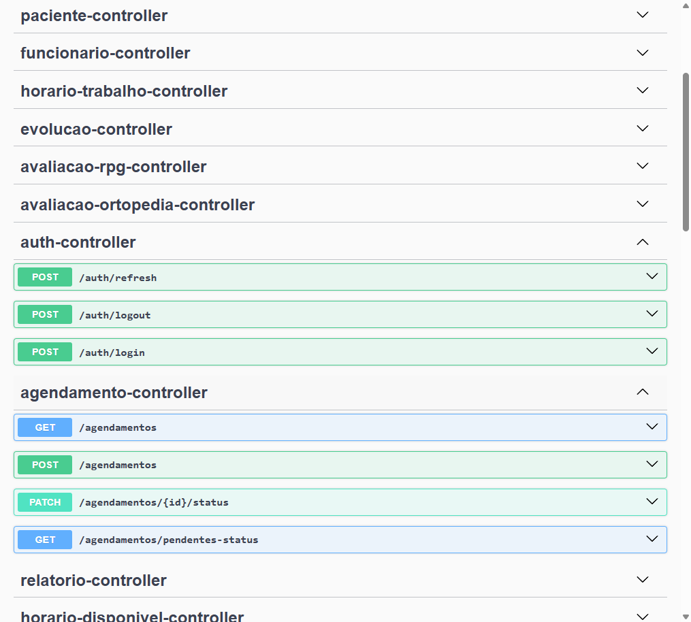
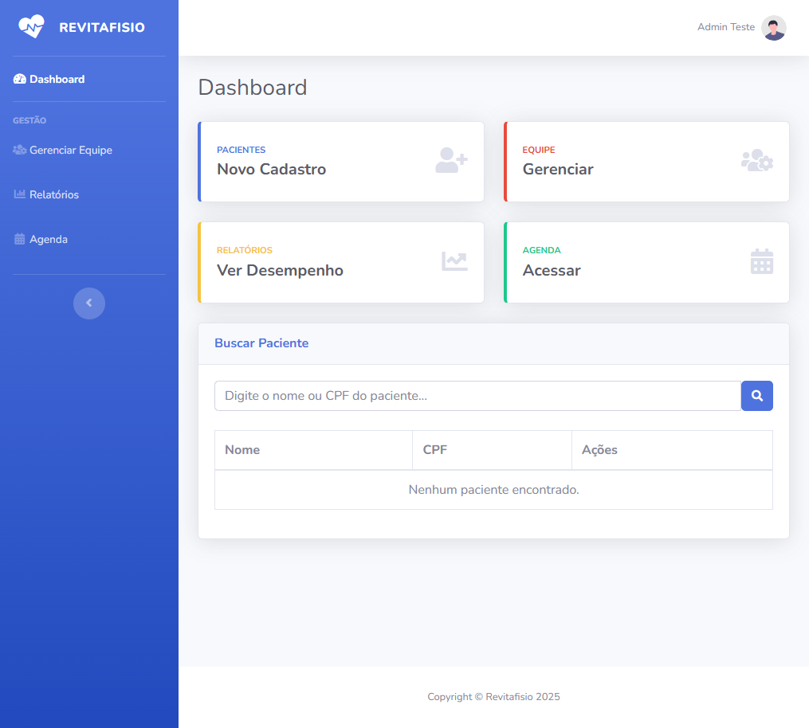
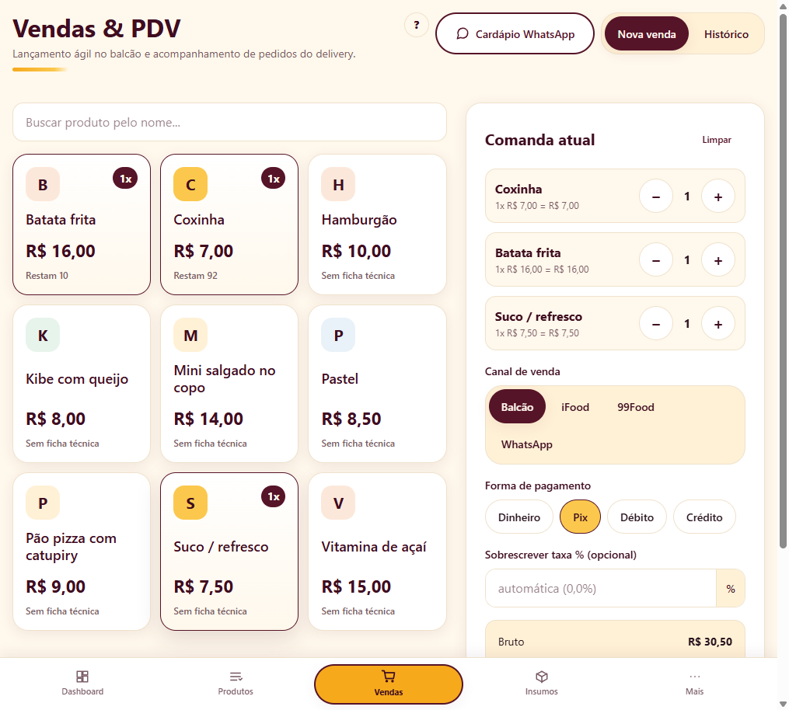
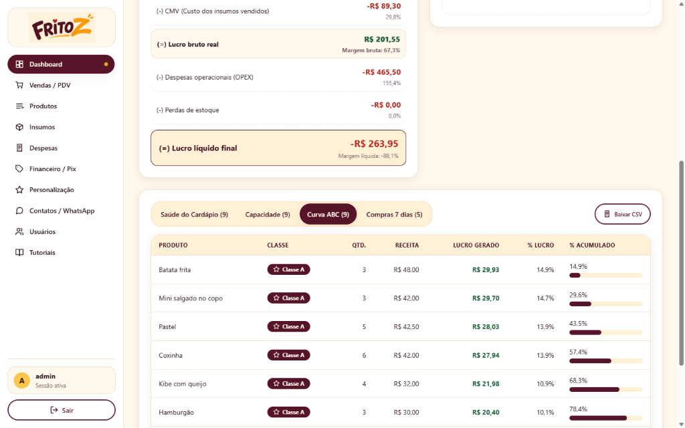
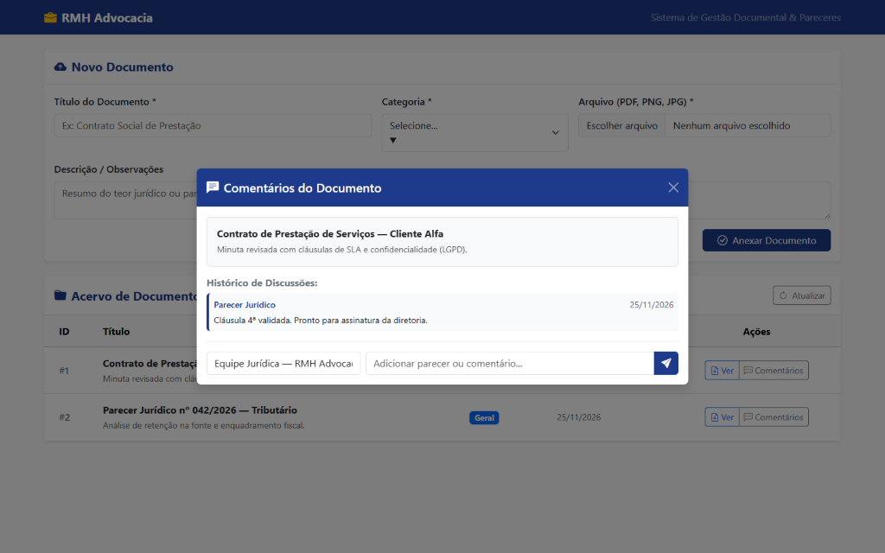
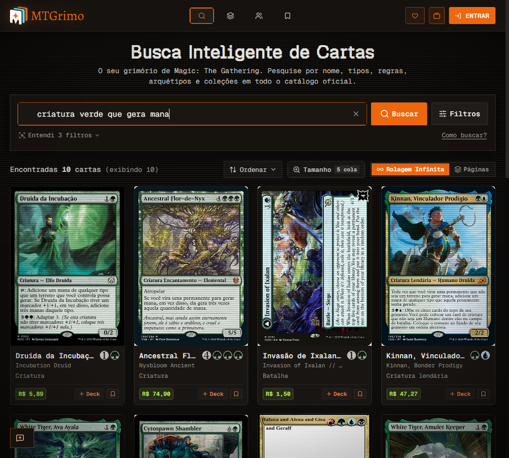
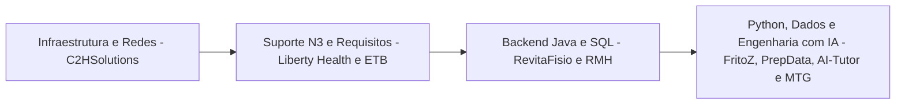

# 👋 Edmar Yan Faria de Melo

### Desenvolvedor Backend (Java / Python) · Dados & Engenharia com IA

*Construindo backends seguros, modelagem relacional consistente e automações orientadas a dados — com base prática em Sustentação N3, Requisitos e Infraestrutura.*

  
  
  

  <a href="#01-sobre-mim">01 · Sobre</a> &nbsp;·&nbsp;
  <a href="#02-projetos-principais">02 · Projetos</a> &nbsp;·&nbsp;
   &nbsp;·&nbsp;
  <a href="#04-visão-geral-dos-projetos">04 · Resumo</a> &nbsp;·&nbsp;
  <a href="#05-competências-técnicas">05 · Stack</a> &nbsp;·&nbsp;
  <a href="#06-trajetória">06 · Trajetória</a>

---

## 01. Sobre Mim

Sou **Edmar Yan**, graduando em **Ciência da Computação (UDF)**, com formação técnica em **Informática** e **Redes de Computadores** pela **Escola Técnica de Brasília (ETB)**. Antes de focar no desenvolvimento de sistemas, atuei em frentes que moldam diretamente como escrevo backend hoje: **infraestrutura e conectividade**, **suporte técnico em domínio Microsoft (Active Directory)** e **Suporte N3 & levantamento de requisitos** em sistemas hospitalares (acompanhando ciclos entre Desenvolvimento, Homologação e Produção na Liberty Health).

Essa bagagem de sustentação e requisitos faz diferença na prática: em vez de entregar código apenas "funcionando na minha máquina", priorizo **modelagem relacional íntegra, autenticação stateless bem configurada, queries parametrizadas, rastreabilidade de erros e documentação clara para manutenção**.

---

## 02. Projetos Principais

> **Espaço reservado para mídia real:** antes de publicar no repositório especial `EdmarYan/EdmarYan`, salve os prints reais ou GIFs (60–90s) em `./assets/` para substituir os caminhos de imagem abaixo.

<table>
  <tr>
    <td width="46%" valign="top">
      
        
      
    </td>
    <td width="54%" valign="top">
      <strong>CASE 01 &middot; BACKEND JAVA &amp; HEALTHTECH &middot; PÚBLICO</strong>
      <h3>🏥 RevitaFisio — Gestão Clínica de Fisioterapia</h3>
      
<strong>O Problema:</strong> clínicas de fisioterapia com controle fragmentado de grade de horários por profissional, risco de conflito de agenda e ausência de padronização entre fichas de Ortopedia, RPG e evolução por sessão.

      
<strong>A Solução:</strong> API REST em arquitetura modular por domínio (<code>auth</code>, <code>agendamento</code>, <code>paciente</code>, <code>funcionario</code>, <code>relatorio</code>) com <strong>15 tabelas relacionais</strong>, herança JPA <code>SINGLE_TABLE</code> em <code>usuarios</code>, controle de acesso por permissões (RBAC) e validação estrita de schema (<code>ddl-auto=validate</code>).

      
<strong>Evidência de Engenharia:</strong> autenticação stateless com <strong>Spring Security + JWT (JJWT) + BCrypt</strong>, documentação interativa <strong>OpenAPI 3 / Swagger UI</strong>, suíte JUnit 5 (Mockito + MockMvc) e empacotamento <strong>Docker multi-stage</strong>.

      
<code>Java 21</code> <code>Spring Boot 3.5</code> <code>Spring Data JPA</code> <code>Spring Security</code> <code>JWT</code> <code>MySQL 8</code> <code>JUnit 5</code> <code>Docker</code>

      
<a href="https://github.com/EdmarYan/Sistema_Clinico_ETB_2025"><strong>Ver Repositório Público →</strong></a>

    </td>
  </tr>
</table>

 

<table>
  <tr>
    <td width="46%" valign="top">
      
        
      
    </td>
    <td width="54%" valign="top">
      <strong>CASE 02 &middot; PYTHON, DADOS FINANCEIROS &amp; PDV REAL &middot; PÚBLICO</strong>
      <h3>🍟 FritoZ — Gestão Financeira, CMV, Estoque WAC &amp; PDV</h3>
      
<strong>O Problema:</strong> operação real de lanchonete sem visibilidade de margem líquida por canal (Balcão vs delivery/maquininha), sem baixa automática de insumos por receita e sem controle de custo médio ponderado.

      
<strong>A Solução:</strong> plataforma transacional com <strong>API FastAPI + SQLAlchemy + PostgreSQL</strong>, ficha técnica (BOM) com baixa atômica via <code>SELECT ... FOR UPDATE</code>, cálculo de <strong>Custo Médio Ponderado (WAC)</strong>, <strong>DRE operacional</strong>, <strong>Curva ABC</strong>, gerador <strong>Pix EMV (CRC16-CCITT)</strong>, painel SPA zero-build e Landing Page React sincronizada.

      
<strong>Evidência de Engenharia:</strong> 4 migrations SQL versionadas, seed idempotente (<code>--dry-run</code> / <code>--apply</code>), <strong>12 testes integrados de backend</strong> (JWT <code>alg=none</code>, rate limit 429, rollback transacional, CSV injection) e script de verificação WCAG AA / XSS.

      
<code>Python</code> <code>FastAPI</code> <code>SQLAlchemy</code> <code>PostgreSQL</code> <code>Pydantic</code> <code>React + Vite</code> <code>Docker</code> <code>Caddy</code>

      
<a href="https://github.com/EdmarYan/Fritoz"><strong>Ver Repositório Público →</strong></a>

    </td>
  </tr>
</table>

 

<table>
  <tr>
    <td width="46%" valign="top">
      
    </td>
    <td width="54%" valign="top">
      <strong>CASE 03 &middot; BACKEND JAVA CORPORATIVO &middot; PÚBLICO</strong>
      <h3>📄 RMH Gestão de Documentos</h3>
      
<strong>O Problema:</strong> centralizar o armazenamento de documentos jurídicos (PDF, JPG, PNG), evitar sobrescrita de arquivos no servidor e manter histórico de pareceres/comentários por documento.

      
<strong>A Solução:</strong> API REST em <strong>Java 21 + Spring Boot + PostgreSQL</strong> para upload <code>multipart/form-data</code> com nomeação única via <code>UUID</code>, streaming de download via <code>UrlResource</code> e registro cronológico de comentários vinculados por chave estrangeira.

      
<strong>Evidência de Engenharia:</strong> configuração externalizada por variáveis de ambiente no <code>application.properties</code> e provisionamento de banco com PostgreSQL via Docker Compose com bind restrito a <code>127.0.0.1</code>.

      
<code>Java 21</code> <code>Spring Boot</code> <code>Spring Data JPA</code> <code>PostgreSQL</code> <code>Docker Compose</code>

      
<a href="https://github.com/EdmarYan/gestao-documentos-rmh"><strong>Ver Repositório Público →</strong></a>

    </td>
  </tr>
</table>

---

## 03. Dados, IA, Automação & Engenharia Colaborativa

<table>
  <tr>
    <td width="46%" valign="top">
      
        
      
    </td>
    <td width="54%" valign="top">
      <strong>CASE 04 &middot; SEARCH ENGINE, RUST &amp; ARQUITETURA DISTRIBUÍDA &middot; COLABORATIVO</strong>
      <h3>🧙‍♂️ Plataforma MTG — Busca Determinística &amp; Análise de Commander</h3>
      
<strong>O Contexto:</strong> plataforma colaborativa (Web + Mobile + Backend núcleo) para busca avançada em catálogo oficial de <strong>118.000+ cartas e 123.000+ faces</strong>, validação de regras de Commander, sinergias EDHREC e cotações multimoeda (BRL e USD).

      
<strong>Arquitetura &amp; Engenharia:</strong> backend <em>Backend-First</em> em <strong>Rust (Axum + Tokio + SQLx)</strong> sobre <strong>PostgreSQL 16</strong> (<code>pg_trgm</code>, FTS e índices GIN) e <strong>Redis 7</strong>, com provedores desacoplados (Scryfall, EDHREC, Cards Realm / LigaMagic) protegidos por <em>Rate Limiter</em> e <em>Circuit Breaker</em>, parser determinístico de linguagem natural (PT-BR &rarr; AST &rarr; SQL sem LLM) e 8 suítes de testes automatizados.

      
<code>Rust / Axum</code> <code>PostgreSQL 16</code> <code>Redis 7</code> <code>React 19</code> <code>React Native / Expo</code> <code>SQLite</code> <code>Docker</code>

      
<em>Repositório colaborativo privado (<code>jobasgon/plataforma-mtg</code>).</em>

    </td>
  </tr>
</table>

 

<table>
  <tr>
    <td width="50%" valign="top">
      <strong>PÚBLICO (COLABORATIVO) &middot; MACHINE LEARNING &amp; IA SIMBÓLICA</strong>
      <h4>🧠 PrepData — Sistema Especialista + Árvore de Decisão</h4>
      
Combina uma <code>DecisionTreeClassifier</code> (<strong>Scikit-learn</strong>) sobre métricas de dataset (linhas, % nulos, categóricas e desbalanceamento) com um <strong>motor de inferência SE/ENTÃO</strong> em Python (<code>regras.csv</code>) com resolução de conflitos por especificidade e auditoria exaustiva de 27 combinações (0 regras mortas, 0 lacunas).

      
<code>Python</code> <code>Pandas</code> <code>Scikit-learn</code> <code>Jupyter / Colab</code>

      
<a href="https://github.com/JaizaCarvalho/prepdata-sistema-especialista"><strong>Ver Repositório (em dupla) →</strong></a>

    </td>
    <td width="50%" valign="top">
      <strong>PÚBLICO &middot; ENGENHARIA DE AGENTES &amp; GOVERNANÇA IA</strong>
      <h4>🤖 AI-Tutor &amp; AI Memory Ecosystem</h4>
      
Camada de orquestração para agentes de IA de engenharia e estudo: conecta <strong>Lifecycle Hooks</strong> (<code>PreInvocation</code>, <code>PreToolUse</code>, <code>PostToolUse</code>, <code>Stop</code>) ao motor <code>ai-memory</code>, aplica orçamento anti-loop (<code>retrieval-adaptativo</code>), roteamento por <code>.ai-memory.toml</code> e políticas distintas (<em>Tutor Socrático</em>, <em>Vibe Coding</em> e <em>AppSec</em>).

      
<code>Bash</code> <code>JSON Hooks</code> <code>TOML</code> <code>Agent Skills</code> <code>MCP / ai-memory</code>

      
<a href="https://github.com/EdmarYan/AI-Tutor"><strong>Ver Repositório Público →</strong></a>

    </td>
  </tr>
</table>

---

## 04. Visão Geral dos Projetos

| Projeto | Domínio / Trilha | Stack Principal | Diferencial Técnico Comprovado | Repositório |
| :--- | :--- | :--- | :--- | :--- |
| **RevitaFisio** | HealthTech · Trilha A (Java) | Java 21, Spring Boot 3.5, JPA, MySQL 8 | 15 tabelas, JWT stateless + BCrypt, OpenAPI, JUnit 5 e Docker | [`Sistema_Clinico_ETB_2025`](https://github.com/EdmarYan/Sistema_Clinico_ETB_2025) |
| **FritoZ** | PDV &amp; Finanças · Trilha B (Python/SQL) | Python, FastAPI, SQLAlchemy, PostgreSQL | Estoque WAC atômico, Ficha Técnica, DRE, Curva ABC, Pix EMV e 12 testes | [`Fritoz`](https://github.com/EdmarYan/Fritoz) |
| **RMH Documentos** | Jurídico · Trilha A (Java) | Java 21, Spring Boot, JPA, PostgreSQL | Upload UUID seguro, streaming de arquivo, comentários e Docker | [`gestao-documentos-rmh`](https://github.com/EdmarYan/gestao-documentos-rmh) |
| **Plataforma MTG** | Search &amp; Deck Analysis · Colaborativo | Rust/Axum, PostgreSQL 16, Redis 7, React/Expo | Catálogo 118k+ cartas, `pg_trgm`/GIN, Circuit Breaker e 8 suítes de testes | *Privado (`jobasgon`)* |
| **PrepData** | Dados &amp; IA · Trilha B (Python/ML) | Python, Pandas, Scikit-learn | Árvore de Decisão + motor SE/ENTÃO auditado em 27 cenários | [`prepdata-sistema-especialista`](https://github.com/JaizaCarvalho/prepdata-sistema-especialista) |
| **AI-Tutor** | Automação IA · Trilha B (Agentes) | Hooks JSON, TOML, Bash, Agent Skills | Memória persistente (`ai-memory`), orçamento anti-loop e AppSec | [`AI-Tutor`](https://github.com/EdmarYan/AI-Tutor) |

---

## 05. Competências Técnicas

<table>
  <tr>
    <td width="33%" valign="top">
      <strong>Backend Java (Principal)</strong> 
      Java 21 &middot; Spring Boot &middot; Spring Data JPA / Hibernate &middot; Spring Security &middot; JWT &middot; BCrypt &middot; Bean Validation &middot; Maven &middot; JUnit 5 / Mockito
    </td>
    <td width="33%" valign="top">
      <strong>Python, Dados &amp; IA</strong> 
      Python 3 &middot; FastAPI &middot; SQLAlchemy &middot; Pydantic &middot; Pandas &middot; Scikit-learn &middot; Sistemas Especialistas &middot; Agent Skills &amp; Hooks
    </td>
    <td width="33%" valign="top">
      <strong>Bancos de Dados &amp; SQL</strong> 
      PostgreSQL (<code>pg_trgm</code>, GIN, FTS) &middot; MySQL 8 &middot; SQLite &middot; Modelagem Relacional &middot; DDL/DML &middot; Migrations SQL &amp; Flyway
    </td>
  </tr>
  <tr>
    <td width="33%" valign="top">
      <strong>Frontend &amp; Mobile</strong> 
      JavaScript / TypeScript &middot; React &middot; Vite &middot; HTML5 / CSS3 &middot; Flutter / Dart &middot; React Native / Expo
    </td>
    <td width="33%" valign="top">
      <strong>Infraestrutura &amp; Sustentação</strong> 
      Docker &middot; Docker Compose &middot; Linux / WSL &middot; Redes &middot; Active Directory &middot; Suporte N3 &middot; Ambientes Dev / Homolog / Prod
    </td>
    <td width="33%" valign="top">
      <strong>Engenharia &amp; Segurança</strong> 
      Levantamento de Requisitos &middot; Swagger / OpenAPI 3 &middot; Git / GitHub &middot; AppSec (OWASP, Hash Lento, Queries Parametrizadas)
    </td>
  </tr>
</table>

---

## 06. Trajetória

---

## 07. Vamos Conversar

Aberto a oportunidades como **Desenvolvedor Backend / Sustentação Java Jr** ou **Dados / Analytics / Automação com IA Jr** (presencial em Brasília-DF ou remoto).

  
  

